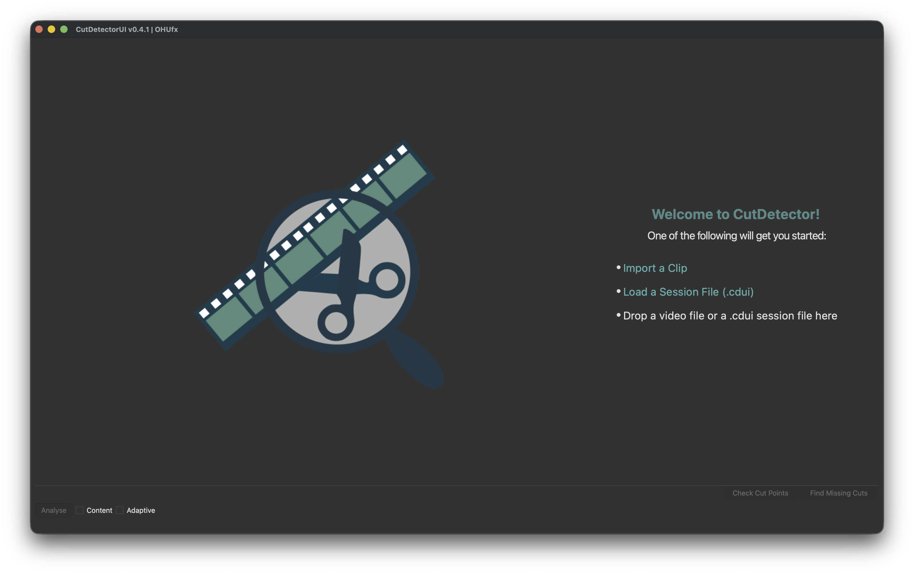

# Import & Sessions

Getting a clip into CutDetectorPro takes one drag. Getting it back later takes another.

{ width=400px align=right }

## Import a clip

Pick whichever you like best:

- **Drag & drop** a video file into an empty window
- Click **Import a Clip** on the landing page
- Choose **File → Import Clip...** from the menu
- Press ++ctrl+i++ (++cmd+i++ on macOS)

??? question "Which video formats work?"

    CutDetectorPro reads video through [PySceneDetect](https://www.scenedetect.com){ target=_blank rel="noopener noreferrer" } and OpenCV,
    so it opens the formats those can decode. That covers the common containers such as `.mov`, `.mp4`, `.mkv` and `.avi`.
    The import dialog doesn't filter by file type, so you can pick any file and see if it opens.

    If a clip won't open, transcode it to an h264 `.mp4` and try again.

<!-- TODO(frank): confirm the list of formats/codecs you have tested, e.g. ProRes, DNxHD, MXF -->

## Import cuts from an edit

Already have the edit of this clip as an **OTIO, EDL, XML (Final Cut Pro 7) or AAF** file? Take its cuts
instead of detecting them. A clip has to be loaded first, then:

- Click **Import Cuts...** next to the Analyse button
- Choose **File → Import Cuts...** from the menu
- Drag & drop the file onto the window

=== ":material-magnify-scan: Before the clip is analysed"

    The file provides the cuts on its own. The [Spike Graph](spike_graph.md) shows them as full spikes, with nothing in between.

=== ":material-content-cut: On top of an analysis"

    The graph stays as it is. Cuts that aren't in the file are deleted ([blacklisted](spike_graph.md#editing-in-the-graph), red); cuts only the file has are added (whitelisted, green).
    The [Shots Table](shots_table.md) is rebuilt for this, which empties shot names and custom columns, so CutDetectorPro asks first and tells you how many of your manually added cuts aren't in the file.

Shots take their names from the clips in the file. Gaps become shots that aren't flagged, and a dissolve becomes a cut where it starts.
Several video tracks are combined into one list of cuts.

!!! info "How the file lines up with the clip"

    The file is expected to describe the loaded clip from its first frame, whatever timecode its timeline starts at.
    Shots past the end of the clip, or outside the [sub-range](sub_range.md)'s in/out points, are left out with a warning.
    An EDL is read at the clip's frame rate; for the other formats, a warning tells you if their frame rate differs from the clip's.

## Save and reload your work

Everything you do lives in a **session**: the analysis, your threshold, every manual edit and your text columns.
Save it as a `.cdui` file with ++ctrl+s++ (++cmd+s++ on macOS).

A session file is fully portable. The analysis data is stored inside it, so it opens instantly on any machine and you can hand it to a colleague.

To load one:

- **Drag & drop** a `.cdui` file into an empty window
- Click **Load a Session File** on the landing page
- Choose **File → Load Session...** from the menu
- Press ++ctrl+o++ (++cmd+o++ on macOS)

!!! tip "You don't have to save just to avoid re-analysing"

    CutDetectorPro also remembers the analysis of every clip on its own, and offers to reuse it next time you import that clip.
    See [Re-use a previous analysis](detecting_cuts.md#re-use-a-previous-analysis).

## What's next?

- :material-magnify-scan:{ .lg .middle } **Detect cuts**

    Press Analyse and let CutDetectorPro do the work.

    [:octicons-arrow-right-24: Detecting cuts](detecting_cuts.md)

- :material-timeline-clock:{ .lg .middle } **Only part of the clip?**

    Set in and out points before you analyse.

    [:octicons-arrow-right-24: Sub-range analysis](sub_range.md)

