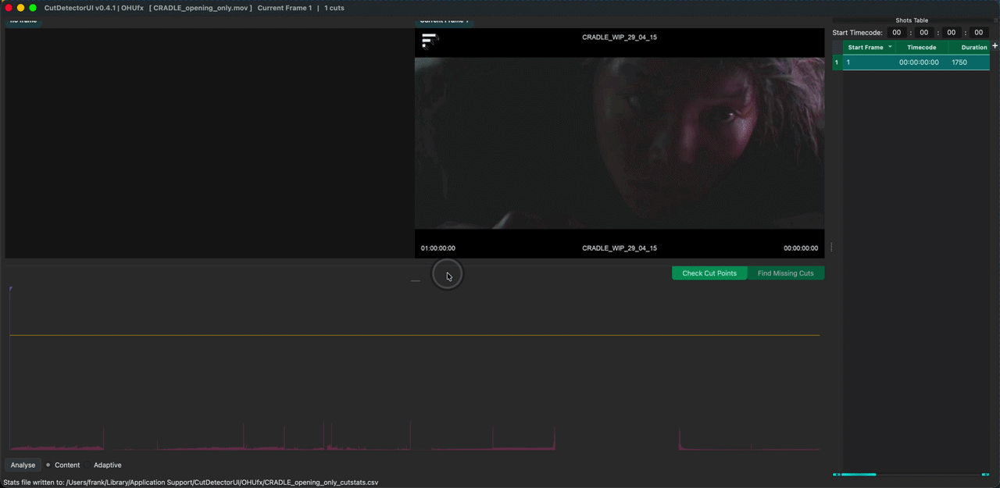
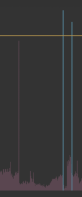
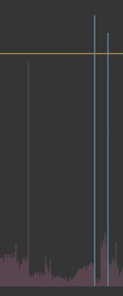

# Spike Graph

## Reading the graph

Once the analysis is done, every frame of the clip is a spike. The taller the spike, the more that frame differs from the one before it.
Tall spikes are usually cuts.

- **Click** anywhere in the graph to move the playhead. The frame under it shows in the right viewer, the previous frame in the left one.
- The [Shots Table](shots_table.md) follows the playhead: it always selects the shot the playhead is on.
- Cuts are drawn in teal, [manual additions](#editing-in-the-graph) in bright green and manual deletions in red.

!!! info "Keys for moving around"

    - ++left++ / ++right++ move the playhead one frame at a time *(Preview Mode only)*. After analysis they stay inside the analysed [sub-range](sub_range.md).
    - ++home++ / ++end++ jump straight to the first / last frame, same sub-range limit as above.
    - ++page-up++ / ++page-down++ and ++up++ / ++down++ jump between cuts (table rows). On the first or last shot nothing happens.
    - ++alt++ + click & drag paint-selects spikes for editing.

    All of them are also on the [Shortcuts](shortcuts.md) page.

## Zooming in

Use the zoom slider below the graph (next to the magnifying-glass icon) to see more detail. Zoom is centred on the current frame, so the playhead stays put as the window grows or shrinks around it.

- **Drag the slider** to zoom in and out. Click the icon, or ctrl+click the slider, to reset.
- **Scroll** over the graph to zoom with the mouse wheel, same centring as the slider.
- **Middle-click and drag** to draw a region and zoom straight to it. A plain middle-click with no drag resets the zoom, same as the icon.

The icon tints orange while the graph is zoomed, same as the brightness/scale icons in the [Contact Sheet](contact_sheet.md).

<!-- MEDIA: 6 s loop: drag the zoom slider in, scroll to zoom back out, middle-click-drag a region to zoom straight into it. -->

## The threshold

{ align=right }

The yellow threshold line decides which spikes count as cuts. Every spike above it turns teal and gets a row in the [Shots Table](shots_table.md).
Drag the line up and down until the number of cuts looks right. Nothing is lost when you move it, and your manual edits are kept.

<!-- MEDIA: 6 s loop: drag the threshold line up and down while the cut count in the status bar changes. -->

## Editing in the graph

=== ":octicons-thumbsup-24: Adding cuts"

    { align=left }

    Added cuts are **whitelisted**: they stay cuts no matter where the threshold is. They're drawn as bright green spikes.

    - Click the spike where the new shot starts (use the arrow keys to step frame by frame), then press ++c++ (as in **C**ut).
    - Or hold ++alt++ and click & drag over one or more spikes, then press ++a++ (as in **A**dd).

=== ":octicons-thumbsdown-24: Removing cuts"

    { align=left }

    Removed cuts are **blacklisted**: they never come back, whatever you do with the threshold. They're drawn as bright red spikes.

    - Move to the cut you don't want (use ++page-up++ / ++page-down++ to go from cut to cut), then press ++delete++ or ++backspace++.
    - Or hold ++alt++ and click & drag over one or more spikes, then press ++d++ (as in **D**elete).

!!! tip "Missing a cut?"

    The best way to find and add missing cuts is the [Contact Sheet](contact_sheet.md): click **Find Missing Cuts** or press ++grave++.
    You see the actual frames, not just spikes.
